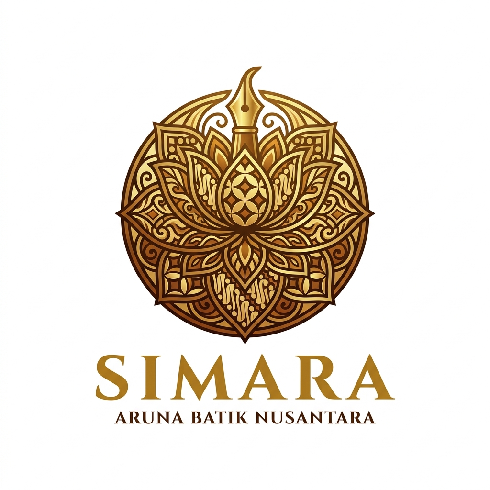

# 🎨 SIMARA - Sistem Informasi Manajemen Aruna Batik Nusantara

<p align="center">
  
</p>

<p align="center">
  <strong>Platform E-Commerce, Katalog Digital, & Sistem Informasi Manajemen Toko Batik Tulis Nusantara</strong>
</p>

<p align="center">
  <a href="https://laravel.com"></a>
  <a href="https://php.net"></a>
  <a href="https://mariadb.org"></a>
  <a href="https://getbootstrap.com"></a>
  <a href="https://github.com/28Rendy/SIMARA-Sistem_Informasi_Manajemen_Aruna_Batik_Nusantara"></a>
</p>

---

## 📌 Tentang SIMARA

**SIMARA (Sistem Informasi Manajemen Aruna Batik Nusantara)** adalah aplikasi berbasis web terpadu yang dirancang untuk mendukung operasional bisnis UMKM batik tulis di Kota Tegal, Jawa Tengah. Aplikasi ini menggabungkan **Etalase E-Commerce Publik**, **Portal Layanan Pelanggan**, serta **Panel Back-Office Manajemen (CMS, Inventaris, & Laporan Keuangan)** dalam satu ekosistem digital yang efisien dan aman.

---

## ✨ Fitur-Fitur Utama

### 🛍️ 1. Halaman Publik (Frontend)
- **Beranda Interaktif**: Banner hero slider dinamis, etalase koleksi batik unggulan, profil filosofi usaha, dan integrasi pemesanan WhatsApp langsung.
- **Top Navigation Bar Responsif**: Dilengkapi tombol scroll panah kiri/kanan & indikator baris scroll agar menu tetap rapi di semua resolusi layar tanpa zoom out.
- **Katalog Produk Lengkap**:
  - Filter kategori (*Batik Siap Pakai / Produksi Sendiri* vs *Kain Batik Setengah Jadi*).
  - Fitur pencarian produk real-time berdasarkan kata kunci nama produk atau motif.
- **Galeri Foto & Artikel Budaya Batik**: Dokumentasi motif karya pembatik serta artikel edukasi pelestarian batik nusantara.
- **Tentang Kami & FAQ Interaktif**: Accordion tanya-jawab interaktif dan informasi kontak galeri.

### 👤 2. Portal Pelanggan
- **Registrasi & Login Akun Pelanggan**: Pendaftaran mandiri pelanggan.
- **Dashboard Pesanan**: Memantau status pesanan (Menunggu Konfirmasi, Diproses, Dikirim, Selesai).
- **Pengaturan Profil**: Pengelolaan data diri, alamat pengiriman, dan upload foto profil pelanggan.

### ⚙️ 3. Backend Admin (Panel Manajemen SIMARA)
- **Active State Indicator Sidebar**: Navigasi sidebar dengan blok warna dinamis bergradien emas-cokelat batik yang menandakan posisi menu dan sub-menu yang sedang aktif.
- **Data Barang & Kategori**: Manajemen inventaris kain setengah jadi, produksi sendiri, jenis kain, motif, dan ukuran.
- **Transaksi & Penjualan**: Pencatatan transaksi kasir toko.
- **Keuangan & Pengeluaran**: Pencatatan pengeluaran kas operasional toko.
- **Kelola Pesanan Online**: Konfirmasi pembayaran dan pembaruan nomor resi / status pesanan dari pelanggan.
- **CMS (Content Management System)**:
  - Kelola Identitas Toko, Logo, Kontak & Media Sosial.
  - Kelola Hero Slider (Banner Beranda).
  - Kelola Galeri Foto & Album.
  - Kelola Tanya Jawab (FAQ).
  - Kelola Berita & Artikel Edukasi.
- **Laporan**: Rekapitulasi laporan penjualan dan pengeluaran kas berformat cetak / PDF.

---

## 🚀 Panduan Instalasi & Menjalankan (Lokal)

Ikuti langkah mudah di bawah ini untuk menjalankan proyek di laptop Anda (Laragon / XAMPP):

### 1. Prasyarat Sistem
- **Web Server Local**: [Laragon](https://laragon.org/) *(sangat disarankan)* atau [XAMPP](https://www.apachefriends.org/)
- **PHP**: Versi 7.4 atau 8.0 - 8.3
- **Database**: MySQL / MariaDB
- **Composer**: [Download Composer](https://getcomposer.org/)
- **Git**: [Download Git](https://git-scm.com/)

---

### 2. Langkah-Langkah Cepat

#### 📥 Langkah 1: Clone Repository
Buka terminal (Git Bash / PowerShell / Command Prompt), arahkan ke folder web server Anda (`C:\laragon\www\` atau `C:\xampp\htdocs\`), lalu jalankan:

```bash
git clone https://github.com/28Rendy/SIMARA-Sistem_Informasi_Manajemen_Aruna_Batik_Nusantara.git
cd SIMARA-Sistem_Informasi_Manajemen_Aruna_Batik_Nusantara
```

---

#### 📦 Langkah 2: Install Dependensi PHP
Jalankan composer untuk mengunduh package Laravel:

```bash
composer install
```

---

#### ⚙️ Langkah 3: Konfigurasi File Environment (`.env`)
Salin file `.env.example` menjadi `.env`:

*Untuk Windows (PowerShell / CMD):*
```powershell
copy .env.example .env
```
*Untuk Git Bash / Linux / macOS:*
```bash
cp .env.example .env
```

Buka file `.env` di text editor (VS Code, Notepad, dll), lalu sesuaikan konfigurasi database:
```env
APP_NAME=SIMARA

DB_CONNECTION=mysql
DB_HOST=127.0.0.1
DB_PORT=3306
DB_DATABASE=simara_batik
DB_USERNAME=root
DB_PASSWORD=
```

> **Catatan:** Buat database kosong bernama `simara_batik` di **phpMyAdmin** (`http://localhost/phpmyadmin`) atau HeidiSQL terlebih dahulu.

---

#### 🔑 Langkah 4: Generate Application Key
Jalankan perintah ini untuk membuat key aplikasi baru:

```bash
php artisan key:generate
```

---

#### 🗄️ Langkah 5: Migrasi Database & Seeder Data Awal
Jalankan migrasi tabel beserta seeder untuk langsung mengisi data dummy (data barang, motif, kategori, admin, galeri, slider, dan FAQ):

```bash
php artisan migrate --seed
```

> 💡 *Jika ingin mereset ulang seluruh database dari awal kapan saja:*
> ```bash
> php artisan migrate:fresh --seed
> ```

---

#### 🚀 Langkah 6: Jalankan Server Lokal
Jalankan server bawaan Laravel:

```bash
php artisan serve
```

Buka browser dan akses alamat berikut:
- **Halaman Utama (Frontend)**: [http://127.0.0.1:8000](http://127.0.0.1:8000)
- **Halaman Login**: [http://127.0.0.1:8000/login](http://127.0.0.1:8000/login)

---

## 🔑 Akun Demo Default

Setelah menjalankan seeder, akun berikut siap digunakan untuk login dan pengujian:

| Role / Akses | Email / Username | Password | Keterangan |
| :--- | :--- | :--- | :--- |
| **Admin / Pemilik** | `admin@arunabatik.com` *(atau username: `admin`)* | `admin123` | Akses penuh dashboard, barang, keuangan, CMS, dan laporan |
| **Lupa Password** | `/forgot` | - | Verifikasi dengan email admin & Nama Ibu: `Ibu Aruna` |

---

## 👥 Panduan Kerja Sama Git untuk Teman Kelompok

Agar kode selalu sinkron dan tidak terjadi bentrok (*conflict*) saat mengerjakan tugas kelompok bersama:

### 1. Sebelum Mulai Coding (Wajib `pull` update terbaru)
```bash
git checkout main
git pull origin main
```

### 2. Setelah Selesai Menambahkan Fitur / Memperbaiki Kode
```bash
git add .
git commit -m "Deskripsi perubahan yang Anda buat"
git push origin main
```

### 3. Jika Ada Update Database / Seeder dari Teman
Jika teman menambahkan tabel atau seeder baru setelah Anda melakukan `git pull`, jalankan:
```bash
php artisan migrate
php artisan db:seed
```

### 4. Jika Tampilan View / Blade Tidak Berubah
Jalankan pembersihan cache Blade:
```bash
php artisan view:clear
php artisan cache:clear
```

---

## 📁 Struktur Direktori Penting

```text
Simara_Batik/
├── app/
│   ├── Http/Controllers/    # Controller (Frontend, Admin, Pelanggan, Auth)
│   └── Models/              # Model Eloquent Database
├── database/
│   ├── migrations/          # Struktur skema tabel database
│   └── seeds/               # Data seeder otomatis (Admin, CMS, Batik)
├── public/
│   ├── asset/               # CSS, JS, Vendor (Bootstrap, SB-Admin, FontAwesome)
│   └── photos/              # Folder penyimpanan foto produk, galeri, slider
├── resources/
│   └── views/
│       ├── auth/            # Halaman Login, Register, Lupa Password
│       ├── frontend/        # Tampilan Landing Page, Produk, Berita, Galeri
│       ├── layouts/         # Layout Admin & Sidebar Panel
│       └── pelanggan/       # Dashboard & Profil Akun Pelanggan
├── routes/
│   └── web.php              # Definisi rute URL aplikasi
└── .env                     # Konfigurasi database & environment lokal
```

---

## 📄 Lisensi
Proyek **SIMARA** ini dikembangkan untuk keperluan akademik, portofolio sumber terbuka (*open-source*), dan operasional UMKM **Aruna Batik Nusantara (Tegal, Jawa Tengah)**.

<p align="center">
  Dibuat dengan ❤️ oleh Tim Pengembang SIMARA
</p>
